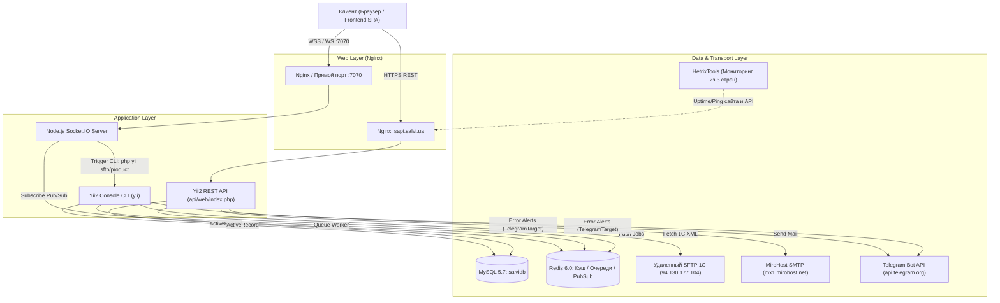

# Архитектура приложения и точки входа

Проект **Salvi Backend** построен на базе шаблона **Yii 2 Advanced Application Template** с выделенным микросервисом на **Node.js** для обслуживания сокетов в реальном времени.

---

## 1. Общая структура каталогов и слоёв

```text
salvi_back/
├── api/             # REST API подсистема (точка входа для фронтенда)
│   ├── components/  # Компоненты сериализации, авторизации, валидации
│   ├── config/      # Конфигурация API (main.php, urlManager, DI)
│   ├── controllers/ # Контроллеры версий v1 и v2
│   ├── job/         # Классы фоновых задач (Queue Jobs)
│   ├── models/      # Формы ввода (LoginForm, RegisterForm и т.д.)
│   ├── services/    # Сервисы фильтрации, генерации Excel/PDF
│   └── web/         # Web-root (index.php)
├── common/          # Общее ядро логики для API и Console
│   ├── components/  # RbacManager, User identity, EmptyLogger, TelegramTarget
│   ├── config/      # Базовые конфиги (main.php, params.php, bootstrap.php)
│   ├── events/      # Слушатели системных событий (AppEvent)
│   ├── helpers/     # Утилиты парсинга XML, изображений, карт
│   └── models/      # ActiveRecord модели БД (User, Product, Order, etc.)
├── console/         # Консольное приложение (CLI, Cron, Парсеры, Очереди)
│   ├── config/      # Конфигурация консольного приложения
│   ├── controllers/ # Консольные контроллеры (Sftp, Budget, Rbac, Search)
│   └── xml/         # Локальное хранилище XML-файлов обмена и lock-файлы
├── nodejs/          # Сервер реального времени на Node.js (Socket.io)
│   ├── index.js     # Точка старта Babel/Node.js
│   └── socket.js    # Логика комнат, сокетов и подписки на Redis Pub/Sub
├── docker/          # Docker-окружение для локальной разработки
└── environments/    # Шаблоны окружений (dev, prod, stage)
```

---

## 2. Основные точки входа (Entry Points)

| Тип | Точка входа в файловой системе | Вызывающий субъект | Назначение |
| :--- | :--- | :--- | :--- |
| **REST API** | `api/web/index.php` | Nginx -> FastCGI | Обработка всех HTTP-запросов от SPA-фронтенда (`sapi.salvi.ua`) |
| **CLI / Cron** | `console/yii` (корень: `yii`) | Crontab / Bash / SSH | Выполнение задач по расписанию, миграций, парсинга |
| **WebSocket** | `nodejs/index.js` -> `socket.js` | Демон `forever` (:7070) | Прием WebSocket-соединений, пуш уведомления, чаты |
| **Queue Worker**| `yii queue/listen` | Демон `systemd` (`yii-queue@1`) | Непрерывное прослушивание очереди Redis и выполнение Jobs |

---

## 3. Схема межсервисного взаимодействия



---

## 4. Глобальные механизмы Bootstrap и Events

При старте любого приложения (API или Console) через `common/config/main.php` регистрируются обязательные модули:

1. **`queue` (`yii\queue\redis\Queue`)**: подключение очереди на базе Redis (канал `queue`).
2. **`queueFile` (`yii\queue\file\Queue`)**: файловая резервная очередь.
3. **`common\events\AppEvent`**: централизованный слушатель событий ActiveRecord:
   * **`Locations::EVENT_AFTER_INSERT`**: автоматически ставит в очередь задачу `LocationAddedJob` (геокодирование адресов).
   * **`Product::EVENT_AFTER_UPDATE`**: при изменении атрибута `delete` автоматически отправляет в очередь задачу `DeleteProductJob`.

---

## 5. Мониторинг надежности и алертинг ошибок

Система мониторинга Salvi включает внешний и внутренний контуры контроля:

1. **Внешний мониторинг доступности ([HetrixTools](https://hetrixtools.com/dashboard/account/settings/)):**
   * Выполняет непрерывную независимую проверку доступности SPA-фронтенда (`salvi.ua`) и REST API (`api.salvi.ua`) из **3 стран**.
   * Контролирует HTTP 200 OK, время отклика и статус SSL-сертификатов, моментально оповещая команду при падении или деградации сервиса.

2. **Внутренний алертинг уровня приложения ([TelegramTarget](file:///C:/Users/Admin/PhpstormProjects/salvi_back/common/components/TelegramTarget.php)):**
   * Для перехвата критических ошибок backend-сервисов в конфигурациях `api/config/main.php` и `console/config/main.php` зарегистрирован кастомный лог-таргет:
     * **Класс:** [`common\components\TelegramTarget`](file:///C:/Users/Admin/PhpstormProjects/salvi_back/common/components/TelegramTarget.php)
     * **Функция:** перехват сообщений уровня `error` (`Logger::LEVEL_ERROR`) и немедленная отправка форматированного алерта в рабочий Telegram-чат команды разработки.
     * **Изоляция сбоев:** отправка работает через cURL с ограничением таймаута (2с) и изолирована блоком `try/catch`, гарантируя, что проблемы на стороне Telegram API не повлияют на жизненный цикл клиентских запросов.
     * **Подробности механизма:** см. [10. Документация алертинга ошибок в Telegram](../flows/10-error-handling-and-telegram-alerts.md).
