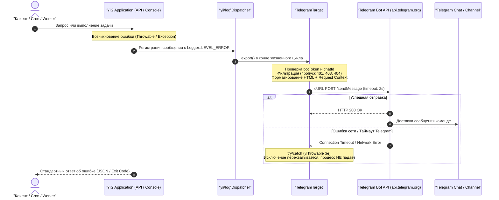

# Механизм: Алертинг и мониторинг ошибок в Telegram

## 1. Назначение механизма
Обеспечивает оперативное автоматическое оповещение команды разработки и DevOps о критических сбоях и ошибках в работе backend-приложения (**Salvi Backend**) в режиме реального времени:
1. **Мгновенная реакция на инциденты:** отправка уведомлений о непредвиденных серверных исключениях (`500 Internal Server Error`, `Database Exception`, ошибки PHP) в выделенный канал или рабочий чат Telegram.
2. **Контекст ошибки «из коробки»:** каждое сообщение содержит полный стек вызова (класс исключения, текст ошибки, файл и строку), а также контекст запроса (HTTP метод, URL, IP-адрес клиента и ID авторизованного пользователя).
3. **Безотказность и безопасность:** отправка алертов изолирована от основного процесса выполнения запросов; сбои сети или недоступность Telegram API не влияют на стабильность системы и работу клиентов.

> [!NOTE]
> **Многоуровневый мониторинг:** `TelegramTarget` отвечает за перехват необработанных внутренних исключений приложения на бэкенде. Для внешнего контроля доступности сервисов (Uptime) настроен независимый мониторинг сайта и API из 3 стран через [HetrixTools](https://hetrixtools.com/dashboard/account/settings/), а системные метрики сервера (CPU, RAM, диски) собираются через Zabbix Agent 2 (подробнее см. [Инфраструктура и сервера](../infrastructure/servers-and-services.md#7-мониторинг-и-алертинг-ошибок-hetrixtools-zabbix--telegram-alerts)).

---

## 2. Архитектура и точки подключения

Механизм реализован в виде кастомного таргета компонента логирования Yii2:

* **Класс компонента:** [`common\components\TelegramTarget`](file:///C:/Users/Admin/PhpstormProjects/salvi_back/common/components/TelegramTarget.php) (наследует `yii\log\Target`).
* **Точки регистрации таргета:**
  1. **REST API (`api/config/main.php`):** перехватывает все критические ошибки при обработке HTTP-запросов от SPA-фронтенда.
  2. **Console CLI (`console/config/main.php`):** перехватывает ошибки при выполнении фоновых консольных скриптов, миграций, очередей `queue/listen` и Cron-задач (`search/update-table`, `budget/index`, `contract` и т.д.).

### Конфигурация в `main.php` компонентов (`api` и `console`):
```php
'components' => [
    'log' => [
        'traceLevel' => YII_DEBUG ? 3 : 0,
        'targets' => [
            [
                'class' => 'yii\log\FileTarget',
                'levels' => ['error', 'warning'],
            ],
            // Таргет для отправки критических ошибок и ошибок БД в Telegram
            [
                'class' => 'common\components\TelegramTarget',
                'levels' => ['error'],
                'logVars' => [], // Не прикреплять $_COOKIE/$_SERVER для чистоты сообщений
            ],
        ],
    ],
],
```

---

## 3. Конфигурационные параметры (Environment Configuration)

Параметры подключения и окружения задаются в конфигурационном файле `common/config/params-local.php` (или `common/config/params.php`):

| Параметр | Тип | Пример значения | Описание |
| :--- | :--- | :--- | :--- |
| `telegramBotToken` | `string` | `1234567890:ABCdef...` | Токен Telegram-бота, выданный `@BotFather`. |
| `telegramChatId` | `string\|int` | `-1001234567890` | Идентификатор целевого чата, группы или канала в Telegram. |
| `telegramEnvironment` | `string` | `'PRODUCTION'` / `'STAGE'` | Название окружения (влияет на цвет визуального индикатора). |

### Свойства класса `TelegramTarget`:
* **`botToken`**: Токен бота (если не задан в конфиге компонента, считывается из `Yii::$app->params['telegramBotToken']`).
* **`chatId`**: ID чата назначения (считывается из `Yii::$app->params['telegramChatId']`).
* **`environment`**: Окружение, по умолчанию `'PRODUCTION'` (считывается из `Yii::$app->params['telegramEnvironment']`).
* **`timeOut`**: Таймаут cURL-запроса к Telegram Bot API в секундах (по умолчанию `2` секунды, таймаут соединения — `1` секунда).
* **`except`**: Массив классов исключений или HTTP-статусов, которые **не отправляются** в Telegram.
* **`logVars`**: Массив суперглобальных переменных для логирования (установлен в пустой массив `[]`, чтобы исключить отправку тяжелых и чувствительных данных `$_SERVER`, `$_COOKIE`, `$_SESSION`).

---

## 4. Фильтрация и защита от шума (Filtering & Rate Control)

Чтобы избежать переполнения чата некритичными оповещениями и действиями пользователей, настроена строгая фильтрация:

1. **Только критические ошибки (`Logger::LEVEL_ERROR`):**
   * В Telegram транслируются исключительно системные ошибки (уровень `error`).
   * Предупреждения (`warning`), инфо-сообщения (`info`), трассировка (`trace`) и профилирование (`profile`) не отправляются.
2. **Исключение клиентских HTTP-ошибок (`$except`):**
   * `yii\web\HttpException:4*` — исключает все клиентские ошибки HTTP 4xx (404 Not Found, 403 Forbidden, 401 Unauthorized, 406 Not Acceptable, 400 Bad Request, 422 Unprocessable Entity и т.д.). В Telegram доходят только 5xx (500 Internal Server Error, сбои БД, необработанные исключения PHP/Throwable).
3. **Защита от превышения лимитов Telegram (4096 символов):**
   * Если длина сформированного HTML-сообщения превышает 4000 символов, текст автоматически обрезается до 3950 символов с добавлением суффикса `\n\n... [Сообщение обрезано]`.

---

## 5. Формат уведомлений в Telegram

Сообщения формируются в формате **HTML** с цветовой индикацией:
* `🔴 [PRODUCTION] ERROR` — для боевого окружения `PRODUCTION`.
* `🟡 [STAGE] ERROR` — для тестового окружения `STAGE` или `LOCAL`.

### Пример алерта для Web API:
```text
🔴 [PRODUCTION] ERROR
Date: 2026-10-23 16:30:15
Category: yii\db\Exception
URL: POST https://api.salvi.ua/v1/order/create
IP: 195.24.12.89
User ID: 142
------------------------------
Type: yii\db\IntegrityException
Message: SQLSTATE[23000]: Integrity constraint violation: 1048 Column 'company_id' cannot be null
File: /var/www/salvi/www_api/common/models/Order.php:184
Code: 23000
```

### Пример алерта для Console CLI / Cron:
```text
🔴 [PRODUCTION] ERROR
Date: 2026-10-23 17:00:02
Category: console\controllers\SearchController
Context: Console Command
------------------------------
Type: Elasticsearch\Common\Exceptions\NoNodesAvailableException
Message: No alive nodes. All 1 nodes were tried down.
File: /var/www/salvi/www_api/vendor/elasticsearch/elasticsearch/src/Elasticsearch/Connections/Connection.php:68
Code: 0
```

---

## 6. Отказоустойчивость и безопасность отправки

Отправка сообщения в Telegram выполняется методом POST на эндпоинт:
`https://api.telegram.org/bot<botToken>/sendMessage`



### Ключевые меры надежности:
1. **Изоляция сбоев (`try-catch`):** Сетевой запрос к Telegram обернут в `try { ... } catch (\Throwable $e) {}`. Если Telegram недоступен, заблокирован или произошел сбой DNS, исключение полностью подавляется и не нарушает логику ответа клиенту.
2. **Жесткие таймауты cURL:** `CURLOPT_TIMEOUT = 2` сек и `CURLOPT_CONNECTTIMEOUT = 1` сек предотвращают зависание рабочих процессов PHP-FPM или воркеров очередей при проблемах с сетью.
3. **Безопасность данных:** Конфиденциальные заголовки и cookie клиентов не передаются благодаря пустой директиве `'logVars' => []`.
