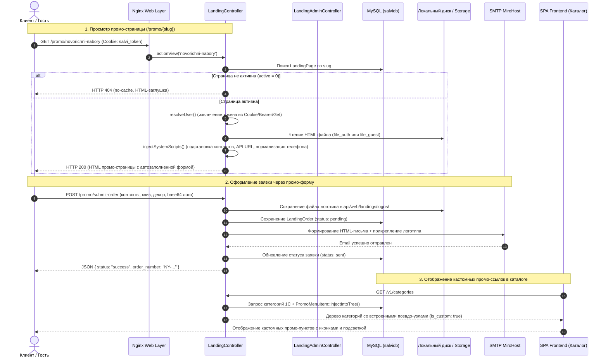
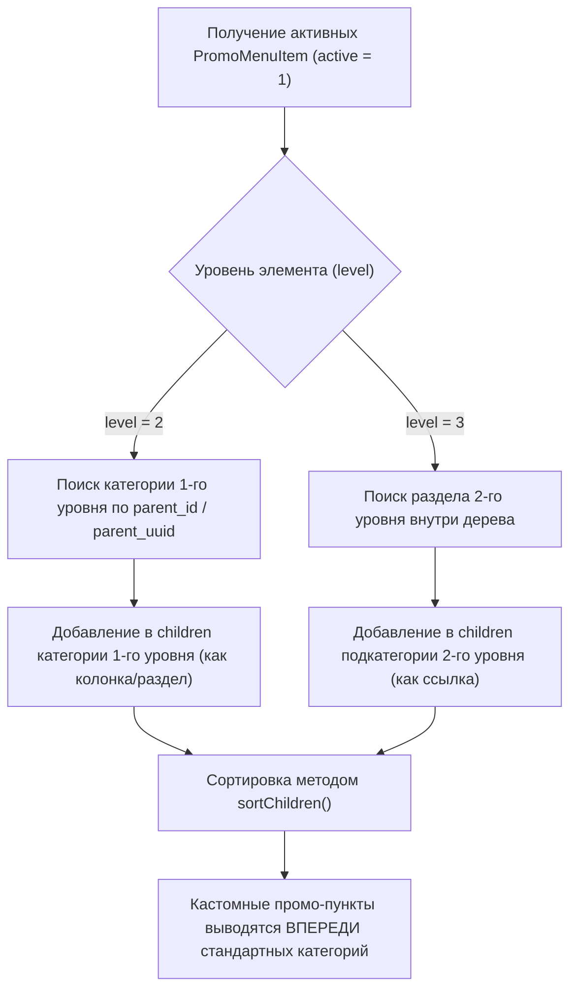

# Механизм: Промо-страницы (лендинги), лидогенерация и кастомные пункты меню

## 1. Назначение и бизнес-контекст

Механизм промо-страниц (**Landing Pages Engine**) разработан для решения ключевой маркетинговой и операционной задачи: **быстрого запуска независимых рекламных посадочных страниц и сезонных промо-кампаний** (например, новогодних корпоративных наборов `novorichni-nabory` и любых будущих лендингов) без необходимости внесения изменений в SPA-фронтенд и проведения отдельного релизного цикла.

### Ключевые возможности механизма:
1. **Docs/Landing-as-Code & No-Deploy релизы:** верстка промо-страницы создается в виде автономного HTML/CSS/JS-файла и загружается маркетологом напрямую через панель администрирования.
2. **Сегментация аудитории (Dual-View):**
   * **Гостевая версия (`file_guest`):** витрина для новых клиентов, органического трафика и рекламных переходов.
   * **Клиентская версия (`file_auth`):** персонализированная страница для действующих клиентов с автоматической подстановкой данных компании, контактного лица, телефона и email.
3. **Бесшовная сквозная авторизация:** передача сессии пользователя из SPA-приложения (`stage.salvi.ua` / `salvi.ua`) на хост промо-страниц (`sapi.salvi.ua` / `api.salvi.ua`) через кросс-доменные Cookie (`.salvi.ua`).
4. **Сквозная лидогенерация и отправка заявок:** сбор детализированных данных (контакты, бюджет, тираж, смета, дедлайны, конфигурация подарка, упаковка, лента, наполнитель, декор и файл логотипа в Base64/файле) с мгновенным оповещением менеджера по электронной почте с прикреплением бренд-файлов.
5. **Динамическая интеграция в меню каталога (`PromoMenuItem`):** внедрение произвольных промо-ссылок на 2-й (разделы/колонки) и 3-й (пункты подкатегорий) уровни каталога с кастомными иконками, открытием в новой вкладке (`target="_blank"`) и цветовым акцентом (красный цвет).

---

## 2. Архитектура и точки входа

* **Административная панель управления:** [`salvi_front/src/views/management/landing/index.vue`](file:///C:/Users/Admin/PhpstormProjects/salvi_front/src/views/management/landing/index.vue) (путь в меню: `/management/landings`, RBAC-право: `managementProductView`).
* **Публичный контроллер отображения и лидогенерации:** [`api/controllers/v1/LandingController.php`](file:///C:/Users/Admin/PhpstormProjects/salvi_back/api/controllers/v1/LandingController.php)
* **REST API Контроллер управления (админка):** [`api/controllers/v1/LandingAdminController.php`](file:///C:/Users/Admin/PhpstormProjects/salvi_back/api/controllers/v1/LandingAdminController.php)
* **ActiveRecord модели:**
  * [`common/models/LandingPage.php`](file:///C:/Users/Admin/PhpstormProjects/salvi_back/common/models/LandingPage.php) — модель промо-страницы и файловых дескрипторов (таблица `landing_pages`).
  * [`common/models/LandingOrder.php`](file:///C:/Users/Admin/PhpstormProjects/salvi_back/common/models/LandingOrder.php) — модель заявок и смет (таблица `landing_orders`).
  * [`common/models/PromoMenuItem.php`](file:///C:/Users/Admin/PhpstormProjects/salvi_back/common/models/PromoMenuItem.php) — модель кастомных пунктов меню каталога (таблица `promo_menu_items`).
* **Точки внедрения в дерево каталога:**
  * [`api/controllers/v1/CategoriesController.php`](file:///C:/Users/Admin/PhpstormProjects/salvi_back/api/controllers/v1/CategoriesController.php#L31-L36) — внедрение промо-пунктов в дерево категорий.
  * [`api/controllers/v1/SearchController.php`](file:///C:/Users/Admin/PhpstormProjects/salvi_back/api/controllers/v1/SearchController.php#L1485-L1545) — фильтрация товаров и обработка `is_custom` узлов на витринах.
  * [`salvi_front/src/components/category/tree-item.vue`](file:///C:/Users/Admin/PhpstormProjects/salvi_front/src/components/category/tree-item.vue) — рендеринг внешних и внутренних ссылок в выпадающем меню.
  * [`salvi_front/src/views/catalog/catalog_slider.vue`](file:///C:/Users/Admin/PhpstormProjects/salvi_front/src/views/catalog/catalog_slider.vue) — вывод промо-пунктов на главной витрине каталога.
* **Сквозная синхронизация токена:** [`salvi_front/src/services/storage.service.js`](file:///C:/Users/Admin/PhpstormProjects/salvi_front/src/services/storage.service.js)

---

## 3. Схема взаимодействия (Mermaid Flow & Sequence)



---

## 4. Структура базы данных и модели

### 4.1. Таблица `landing_pages` (реестр промо-страниц)
Хранит общую конфигурацию лендингов и имена активных HTML-файлов для различных сегментов пользователей.

| Поле | Тип | Описание |
| :--- | :--- | :--- |
| `id` | `INT AUTO_INCREMENT` | Первичный ключ. |
| `slug` | `VARCHAR(100) UNIQUE` | URL-идентификатор страницы (например, `novorichni-nabory`). |
| `title` | `VARCHAR(255)` | Служебное и публичное название страницы. |
| `file_test` | `VARCHAR(255)` | Имя файла для тестового предпросмотра (под администратором). |
| `file_guest` | `VARCHAR(255)` | Имя файла боевой версии для неавторизованных посетителей. |
| `file_auth` | `VARCHAR(255)` | Имя файла боевой версии для авторизованных клиентов. |
| `manager_email` | `VARCHAR(255)` | Email-адрес ответственного менеджера для получения заявок. |
| `active` | `INT DEFAULT 1` | Флаг активности (1 — активна, 0 — отдается 404). |
| `created_at` / `updated_at` | `INT(11)` | Unix-метки времени создания и обновления. |

### 4.2. Таблица `landing_orders` (заявки и сметы с промо-страниц)
Хранит все входящие лиды, контактные данные, детальную конфигурацию подарочных наборов и файлы логотипов.

| Поле | Тип | Описание |
| :--- | :--- | :--- |
| `id` | `INT AUTO_INCREMENT` | Первичный ключ. |
| `landing_page_id` | `INT NULL` | Внешний ключ на `landing_pages.id`. |
| `order_number` | `VARCHAR(64)` | Уникальный номер заявки (формат: `NY-YYMMDD-XXXX`). |
| `name` | `VARCHAR(255)` | Контактное лицо заказчика. |
| `phone` | `VARCHAR(64)` | Нормализованный телефон клиента (`+380XXXXXXXXX`). |
| `email` | `VARCHAR(255)` | Электронная почта клиента. |
| `company` | `VARCHAR(255)` | Название компании заказчика. |
| `channel` | `VARCHAR(64)` | Предпочтительный канал связи (Телефон, Telegram, Viber и т.д.). |
| `comment` | `TEXT` | Произвольный текстовый комментарий клиента. |
| `budget` | `VARCHAR(64)` | Выбранный ценовой диапазон на один набор. |
| `qty` | `INT` | Количество требуемых подарочных наборов (тираж). |
| `total_estimate` | `DECIMAL(12,2)` | Общая ориентировочная смета заказа (в гривнах). |
| `deadline` | `VARCHAR(64)` | Желаемый срок поставки / дата готовности. |
| `wishes` | `TEXT` | Дополнительные пожелания по составу. |
| `interests` | `TEXT` | Выбранные категории интересов/наполнения. |
| `packaging` | `VARCHAR(255)` | Тип выбранной упаковки (коробка, крафт-бокс, тубус и т.д.). |
| `filler` | `VARCHAR(255)` | Тип и цвет наполнителя (стружка, бумага тишью). |
| `ribbon` | `VARCHAR(255)` | Цвет и материал брендированной ленты. |
| `decor` | `TEXT` | Выбранные элементы новогоднего декора. |
| `logo_file` | `VARCHAR(255)` | Имя сохраненного файла логотипа клиента на диске. |
| `logo_placement` | `VARCHAR(255)` | Выбранное место нанесения логотипа. |
| `raw_data` | `MEDIUMTEXT` | Полный сырой JSON-слепок всех переданных полей формы. |
| `user_id` | `INT NULL` | ID авторизованного пользователя Salvi (если клиент авторизован). |
| `ip` | `VARCHAR(45)` | IP-адрес отправителя заявки. |
| `email_status` | `VARCHAR(32)` | Статус отправки email менеджеру (`pending`, `sent`, `failed`). |
| `email_error` | `TEXT NULL` | Текст ошибки почтового сервера при сбое отправки. |

### 4.3. Таблица `promo_menu_items` (кастомные промо-пункты каталога)
Позволяет встраивать ссылки на промо-страницы или внешние разделы прямо в стандартную навигационную структуру каталога 1С.

| Поле | Тип | Описание |
| :--- | :--- | :--- |
| `id` | `INT AUTO_INCREMENT` | Первичный ключ. |
| `landing_page_id` | `INT NULL` | Опциональная привязка к лендингу. |
| `title` | `VARCHAR(255)` | Текст пункта меню (название ссылки). |
| `url` | `VARCHAR(500)` | Целевая ссылка (внутренняя или внешняя). |
| `icon` | `VARCHAR(255)` | Имя файла графической иконки (в `@api/web/landings/menu_icons/`). |
| `level` | `SMALLINT` | Уровень вложенности: `2` (раздел/колонка) или `3` (пункт в разделе). |
| `parent_id` | `INT` | ID родительской категории в таблице `category`. |
| `parent_uuid` | `VARCHAR(255)` | UUID родительской категории 1С. |
| `sort` | `INT DEFAULT 0` | Порядок сортировки (промо-пункты имеют наивысший приоритет над категориями с `sort = null`). |
| `highlight` | `SMALLINT DEFAULT 0`| Флаг акцентной подсветки (1 — красный цвет текста). |
| `target_blank` | `SMALLINT DEFAULT 1`| Открывать ссылку в новой вкладке браузера. |
| `active` | `SMALLINT DEFAULT 1`| Флаг активности пункта в меню каталога. |

---

## 5. Таблица REST API эндпоинтов

### 5.1. Публичные маршруты (`LandingController`)
Управляются правилами роутинга в [`api/config/main.php`](file:///C:/Users/Admin/PhpstormProjects/salvi_back/api/config/main.php#L72-L75). Аутентификация является опциональной (`authenticator.optional`).

| Метод | URL | Экшен контроллера | Аутентификация | Описание |
| :--- | :--- | :--- | :--- | :--- |
| **`GET`** | `/promo/<slug>` | `LandingController::actionView($slug)` | Опционально | Отдача HTML-разметки промо-страницы с инжекцией скриптов и данных пользователя. |
| **`GET`** | `/promo` | `LandingController::actionView()` | Опционально | Дефолтная промо-страница (`slug = novorichni-nabory`). |
| **`POST`** | `/promo/submit-order` | `LandingController::actionSubmitOrder()` | Опционально | Приём заявки, сохранение логотипа, отправка email менеджеру. |
| **`GET`** | `/v1/landing/user-info`| `LandingController::actionUserInfo()` | Опционально | Асинхронное получение профиля текущего пользователя для клиентских скриптов. |

### 5.2. Административные маршруты (`LandingAdminController`)
Требуют обязательной авторизации под учетной записью с правами `managementProductView`, `admin` или `superadmin`.

| Метод | URL | Экшен контроллера | Описание |
| :--- | :--- | :--- | :--- |
| **`GET`** / **`POST`** | `/v1/landing-admin/settings` | `LandingAdminController::actionSettings()` | Получение или сохранение основных настроек промо-страницы (email менеджера, название, активность). |
| **`POST`** | `/v1/landing-admin/toggle-active` | `LandingAdminController::actionToggleActive()` | Быстрое мгновенное переключение флага активности страницы (on/off). |
| **`POST`** | `/v1/landing-admin/upload-file` | `LandingAdminController::actionUploadFile()` | Загрузка HTML-файла страницы (`type`: `guest` или `auth`, лимит до 25 МБ). |
| **`GET`** | `/v1/landing-admin/orders` | `LandingAdminController::actionOrders()` | Реестр заявок с пагинацией, фильтрацией по странице и полнотекстовым поиском. |
| **`GET`** | `/v1/landing-admin/order` | `LandingAdminController::actionOrder($id)` | Полная карточка заявки с сырыми данными (`raw_data`) и ссылкой на логотип. |
| **`GET`** | `/v1/landing-admin/menu-items` | `LandingAdminController::actionMenuItems()` | Список кастомных пунктов меню и списки родительских категорий 1 и 2 уровней. |
| **`POST`** | `/v1/landing-admin/save-menu-item`| `LandingAdminController::actionSaveMenuItem()`| Создание или редактирование промо-пункта меню со сбросом кэша каталога. |
| **`POST`** | `/v1/landing-admin/upload-menu-icon`| `LandingAdminController::actionUploadMenuIcon()`| Загрузка графической иконки пункта меню (PNG, JPG, WEBP, SVG до 5 МБ). |
| **`POST`** | `/v1/landing-admin/delete-menu-item`| `LandingAdminController::actionDeleteMenuItem()`| Удаление промо-пункта со сбросом кэша каталога. |
| **`POST`** | `/v1/landing-admin/toggle-menu-item`| `LandingAdminController::actionToggleMenuItem()`| Быстрое переключение активности пункта меню со сбросом кэша. |

---

## 6. Детальные алгоритмы работы

### 6.1. Сквозная авторизация и выбор версии HTML
Когда посетитель переходит по адресу `https://sapi.salvi.ua/promo/novorichni-nabory`, метод `resolveUser()` идентифицирует статус пользователя:
1. Проверяет контекст `Yii::$app->user->identity`.
2. Если сессия пуста, проверяет параметр URL `?auth_token=...`.
3. Если параметр отсутствует, считывает Cookies: `salvi_token` или `access_token`. 
   > [!NOTE]
   > Благодаря модулю [`salvi_front/src/services/storage.service.js`](file:///C:/Users/Admin/PhpstormProjects/salvi_front/src/services/storage.service.js), авторизационный токен пользователя при входе на SPA-фронтенде сохраняется с директивой `domain=.salvi.ua; SameSite=Lax; Secure`. Это обеспечивает автоматическую передачу токена на бэкенд поддомена `sapi.salvi.ua`.
4. При нахождении токена вызывается `User::findIdentityByAccessToken($token)`.

**Приоритет выбора файла разметки:**
* **Для авторизованного клиента:** `file_auth` $\rightarrow$ `file_guest` $\rightarrow$ `file_test`.
* **Для неавторизованного гостя:** `file_guest` $\rightarrow$ `file_auth` $\rightarrow$ `file_test`.

### 6.2. Инжекция системных скриптов (`injectSystemScripts`)
Чтобы маркетологу не приходилось вручную настраивать сетевые адреса API и обработчики форм, сервер Salvi автоматически модифицирует HTML перед отдачей браузеру:
1. Перед закрывающим тегом `</body>` внедряется системный контекст:
   ```javascript
   window.__SALVI_API_ENDPOINT__ = '/promo/submit-order';
   window.__SALVI_USER__ = {
       name: "Іван Іванов",
       phone: "+380501234567",
       email: "ivan@company.ua",
       company: "ТОВ «Техно-Холдинг»"
   };
   ```
2. Подключается автозаполнение полей формы: скрипт находит форму на странице и автоматически заполняет поля `name`, `phone`, `email` и `company` данными из сессии или `localStorage.getItem('current_user')`.
3. Поддерживается прямая шаблонизация: если в разметке верстки присутствуют макросы `{{user_name}}`, `{{user_phone}}`, `{{user_email}}`, `{{user_company}}`, они заменяются на реальные значения на стороне PHP.
4. Выполняется нормализация украинских номеров телефонов: если телефон сохранен в БД как 9 цифр (например, `990077886`), алгоритм приводит его к международному стандарту `+380990077886`.

### 6.3. Жизненный цикл заявки (`actionSubmitOrder`)
1. **Приём полезной нагрузки:** поддерживает как структурированный JSON с вложенными блоками (`contact`, `quiz`, `packaging`, `logo`), так и плоские массивы данных из стандартных HTML-форм.
2. **Валидация:** обязательными полями являются контактное имя и телефон.
3. **Генерация номера:** заявке присваивается номер `NY-YYMMDD-XXXX` (например, `NY-261104-5821`).
4. **Сохранение логотипа:** если клиент прикрепил файл в виде Base64 Data URL, метод `saveLogoFile()` декодирует его и сохраняет в директорию `@api/web/landings/logos/` с уникальным именем `logo_{order_number}_{timestamp}.{ext}`.
5. **Транзакция в БД:** создается запись `LandingOrder` со статусом `email_status = 'pending'`.
6. **Email-оповещение:**
   * Формируется адаптивное фирменное HTML-письмо с разбивкой на 3 блока: контакты, параметры заказа (бюджет, тираж, сумма, дедлайн, пожелания) и оформление (упаковка, наполнитель, лента, декор).
   * Если логотип был загружен, файл прикрепляется прямо к email (`$mailer->attach($logoPathOnDisk)`), а в теле письма формируется прямая ссылка на скачивание.
   * При успешной отправке статус меняется на `'sent'`. При сетевом сбое ошибка логируется в `email_error`, а статус переводится в `'failed'`.

### 6.4. Внедрение кастомных ссылок в дерево меню каталога
Кастомные промо-пункты из таблицы `promo_menu_items` внедряются в дерево категорий каталога "на лету" через статический метод `PromoMenuItem::injectIntoTree(&$tree)`:



**Особенности псевдо-узлов:**
* Узлы получают признак `'is_custom' => true`, уникальный префикс `id => 'promo_' . $item->id`, целевой `'url' => $item->url`, флаги `'target_blank'` и `'highlight'`.
* В [`SearchController.php`](file:///C:/Users/Admin/PhpstormProjects/salvi_back/api/controllers/v1/SearchController.php#L1505-L1545) узлы с `'is_custom' => true` изолируются: они не участвуют в построении тяжелых SQL-запросов к товарам (`buildProductQuery`), что исключает появление ошибок базы данных при навигации.
* При любом сохранении, удалении или переключении промо-пункта в админке автоматически сбрасывается тег кэша Redis:
  ```php
  TagDependency::invalidate(Yii::$app->cache, 'CategoryTreeAllCategories');
  ```

---

## 7. Хранение файлов и инфраструктура

Директории хранения файлов изолированы и создаются автоматически:

| Директория | Путь на сервере | Назначение |
| :--- | :--- | :--- |
| **HTML-верстки страниц** | `common/uploads/landings/{slug}/` | Исходные HTML-файлы лендингов (`guest_*.html`, `auth_*.html`). Каталог защищен от прямого веб-доступа Nginx. |
| **Логотипы клиентов** | `api/web/landings/logos/` | Загруженные файлы логотипов из заявок (доступны по ссылке `https://sapi.salvi.ua/landings/logos/...`). |
| **Иконки меню каталога** | `api/web/landings/menu_icons/` | Графические иконки пунктов меню (`PNG`, `SVG`, `WEBP`). |

> [!IMPORTANT]
> В скрипте автоматического развертывания [`deploy.sh`](file:///C:/Users/Admin/PhpstormProjects/salvi_back/deploy.sh#L57-L73) каталоги `landings/logos`, `landings/menu_icons` и `common/uploads` включены в список исключений бэкапа (`TAR_EXCLUDES`) и автоматически наделяются правами `salvi:salvi` с режимом `775`, что предотвращает потерю пользовательских данных при обновлениях.

---

## 8. Сводная таблица файлов и компонентов механизма

| Файл / Компонент | Назначение в архитектуре |
| :--- | :--- |
| [`api/controllers/v1/LandingController.php`](file:///C:/Users/Admin/PhpstormProjects/salvi_back/api/controllers/v1/LandingController.php) | Публичный контроллер: отдача HTML, авторизация через Cookie, автозаполнение, приём заказов. |
| [`api/controllers/v1/LandingAdminController.php`](file:///C:/Users/Admin/PhpstormProjects/salvi_back/api/controllers/v1/LandingAdminController.php) | Административный API: настройки, загрузка версток, реестр заявок, управление меню каталога. |
| [`common/models/LandingPage.php`](file:///C:/Users/Admin/PhpstormProjects/salvi_back/common/models/LandingPage.php) | ActiveRecord модель страницы лендинга, валидация и управление файловыми версиями. |
| [`common/models/LandingOrder.php`](file:///C:/Users/Admin/PhpstormProjects/salvi_back/common/models/LandingOrder.php) | ActiveRecord модель заявок, форматирование сметы, генерация ссылок на логотип. |
| [`common/models/PromoMenuItem.php`](file:///C:/Users/Admin/PhpstormProjects/salvi_back/common/models/PromoMenuItem.php) | Модель пунктов промо-меню, логика бесшовного внедрения в дерево (`injectIntoTree`). |
| [`api/controllers/v1/CategoriesController.php`](file:///C:/Users/Admin/PhpstormProjects/salvi_back/api/controllers/v1/CategoriesController.php) | Интеграция промо-ссылок в ответ API категорий (`/v1/categories`). |
| [`api/controllers/v1/SearchController.php`](file:///C:/Users/Admin/PhpstormProjects/salvi_back/api/controllers/v1/SearchController.php) | Интеграция промо-ссылок в поисковую витрину каталога с изоляцией от SQL товаров. |
| [`api/config/main.php`](file:///C:/Users/Admin/PhpstormProjects/salvi_back/api/config/main.php) | Маршрутизация красивых URL: `/promo/<slug>`, `/promo/submit-order`. |
| [`salvi_front/src/views/management/landing/index.vue`](file:///C:/Users/Admin/PhpstormProjects/salvi_front/src/views/management/landing/index.vue) | SPA-компонент админки: 3 вкладки (Файлы и настройки, Заявки с поиском, Пункты меню). |
| [`salvi_front/src/services/storage.service.js`](file:///C:/Users/Admin/PhpstormProjects/salvi_front/src/services/storage.service.js) | Кросс-доменная синхронизация токена в Cookie `.salvi.ua`. |
| [`salvi_front/src/views/catalog/catalog_slider.vue`](file:///C:/Users/Admin/PhpstormProjects/salvi_front/src/views/catalog/catalog_slider.vue) | Отображение промо-ссылок на витрине главной страницы каталога. |
| [`salvi_front/src/components/category/tree-item.vue`](file:///C:/Users/Admin/PhpstormProjects/salvi_front/src/components/category/tree-item.vue) | Рендеринг ссылок с поддержкой `target="_blank"` и красного акцента в выпадающем меню. |
| [`deploy.sh`](file:///C:/Users/Admin/PhpstormProjects/salvi_back/deploy.sh) | Автоматическое создание директорий и выставление прав доступа `chmod 775` при деплое. |
