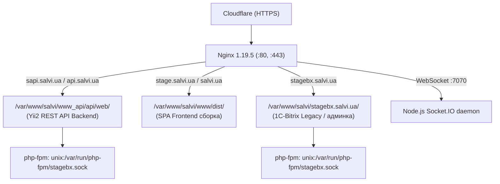
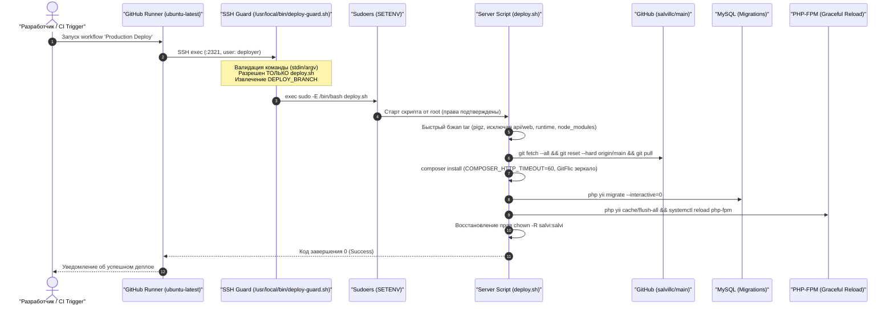

# Инфраструктура, сервера и сервисы (Stage & Prod)

В данном документе зафиксировано актуальное состояние серверной инфраструктуры проекта **Salvi**, полученное в ходе анализа stage-окружения (`stage.salvi.ua`). Архитектура production идентична по структуре и версиям компонентов.

---

## 1. Сводная таблица компонентов и версий

| Компонент / Сервис | Версия на сервере | Порт / Сокет | Назначение / Описание |
| :--- | :--- | :--- | :--- |
| **Операционная система** | CentOS Linux 7.9.2009 (Core) | — | Ядро Linux: `3.10.0-1160.6.1.el7.x86_64` |
| **Web-сервер (Nginx)** | Nginx 1.19.5 | `80`, `443` (HTTP/2) | Обратный прокси, раздача статики, SSL Cloudflare |
| **PHP Runtime** | PHP 7.3.25 (cli / fpm) | `/var/run/php-fpm/*.sock` | Zend OPcache v7.3.25, расширения: `redis`, `gd`, `pdo_mysql`, `zip` |
| **СУБД (MySQL)** | MySQL 5.7.32 | `3306` (127.0.0.1) | Основная база данных (`salvidb`) |
| **Кэш и очереди (Redis)** | Redis server 6.0.9 | `6379` (127.0.0.1) | Очереди задач Yii2 (`queue`), Pub/Sub для WebSockets |
| **Поисковый движок** | Elasticsearch 7.x | `9200` (116.203.191.217) | Выделенный сервер поискового индекса каталога товаров |
| **WebSocket сервер** | Node.js v10.23.0 | `7070` | Socket.IO 2.2 + Express + Redis Subscriber под управлением `forever` |
| **Почтовый транспорт** | Postfix + MiroHost SMTP | `587` (TLS) | Отправка почты (`mx1.mirohost.net:587`, SwiftMailer) |
| **SFTP-шлюз (1С / Каталог)** | OpenSSH SFTP | `22321` | Удаленный сервер `94.130.177.104` для обмена прайс-листами 1С |
| **CI/CD Деплой** | GitHub Actions (`ubuntu-latest`) | SSH `:2321` | Изолированный пользователь `deployer`, скрипт-страж `deploy-guard.sh`, bash-скрипты `deploy.sh` (self-hosted runner выведен из эксплуатации) |
| **Внешний мониторинг доступности** | HetrixTools Uptime Monitor | SaaS (`hetrixtools.com`) | Внешний мониторинг доступности сайта и REST API из 3 стран (HTTP/HTTPS пинг, аптайм, время отклика, SSL) |
| **Инфраструктурный мониторинг** | Zabbix Agent 2 | `10050` | Мониторинг производительности и метрик ОС сервера (CPU, RAM, диски, сервисы) |
| **Алертинг ошибок в TG** | Telegram Bot API | HTTPS (`api.telegram.org`) | Мгновенный алертинг о критических сбоях API и CLI (`common\components\TelegramTarget`) |

---

## 2. Структура виртуальных хостов Nginx

На сервере сконфигурированы следующие виртуальные хосты в `/etc/nginx/conf.d/`:



### Детали виртуальных хостов:

1. **`sapi.salvi.ua` (API Backend):**
   * **Root:** `/var/www/salvi/www_api/api/web/`
   * **Точка входа:** `index.php`
   * **FastCGI:** сокет `unix:/var/run/php-fpm/stagebx.sock` (таймауты до `12000s` для тяжелых отчетов)
   * **CORS:** заголовок `Access-Control-Allow-Origin: https://stage.salvi.ua`

2. **`stage.salvi.ua` (Frontend):**
   * **Root:** `/var/www/salvi/www/dist/`
   * **Маршрутизация:** Single Page Application (`try_files $uri $uri/ /index.html$is_args$args;`)

3. **`stagebx.salvi.ua` (1С-Битрикс):**
   * **Root:** `/var/www/salvi/stagebx.salvi.ua`
   * Поддержка стандартных правил маршрутизации Битрикс (`/bitrix/urlrewrite.php`)

---

## 3. Пулы процессов PHP-FPM (`/etc/php-fpm.d/`)

* **`salvi_api`** (Пользователь: `salvi`): пул, предназначенный для выполнения запросов API Yii2.
* **`stagebx`** (Пользователь: `salvi`): общий FastCGI пул для Bitrix и API.
* **`www`** (Пользователь: `nginx`): системный пул по умолчанию.

---

## 4. Фоновые демоны и службы (Systemd / Forever)

### 1. WebSocket Демон (Node.js)
* **Скрипт управления:** `/var/www/salvi/node.sh`
* **Команды управления:**
  ```bash
  /var/www/salvi/node.sh START  # Запуск демона
  /var/www/salvi/node.sh STOP   # Остановка
  /var/www/salvi/node.sh LIST   # Статус forever
  ```
* **Каталог проекта:** `/var/www/salvi/www_api/nodejs`
* **Команда запуска:** `forever start -c "npm start" "index.js"`
* **Слушает порт:** `7070`
* **Автостарт:** прописан в crontab через `@reboot cd /var/www/salvi/ && ./node.sh START`

### 2. Воркер очередей (Yii Queue Worker)
* **Юнит Systemd:** `/etc/systemd/system/yii-queue@.service`
* **Команда запуска:**
  ```bash
  /usr/bin/php /var/www/salvi/www_api/yii queue/listen --verbose
  ```
* **Пользователь запуска:** `salvi:salvi`
* **Управление службой:**
  ```bash
  systemctl status yii-queue@1
  systemctl restart yii-queue@1
  ```

### 3. GitHub Actions Runner (Legacy)
* **Юнит Systemd:** `/etc/systemd/system/actions.runner.KDTeam-2143-Team-Tool.salvi.service`
* **Пользователь запуска:** `ghrunner`
* **Каталог:** `/home/ghrunner/runsvc.sh`
* *(Устаревший сервис)*: использовался в старой организации KDTeam. При переходе в организацию `salvillc` заменен на стандартные облачные раннеры GitHub (`ubuntu-latest`) с изолированным SSH-доступом через `deployer` и `deploy-guard.sh`.

---

## 5. Планировщики задач Crontab и системные Cron-скрипты

На сервере используется два уровня планирования задач: пользовательский Crontab и системный каталог `/etc/cron.hourly/`.

### 5.1. Системный почасовой скрипт: `/etc/cron.hourly/1elasicindexrecreate`
Скрипт выполняется операционной системой каждый час от имени root и последовательно запускает три критических фоновых механизма:

```bash
#!/bin/sh
/usr/bin/php /var/www/salvi/www_api/yii search/update-table create >> /var/www/salvi/www_api/update-table.txt
/usr/bin/php /var/www/salvi/www_api/yii contract >> /var/www/salvi/www_api/contract.txt
/usr/bin/php /var/www/salvi/www_api/yii clear-logs >> /var/www/salvi/www_api/clear-logs.txt
```

| Команда | Контроллер / Метод | Лог-файл | Назначение |
| :--- | :--- | :--- | :--- |
| `search/update-table create` | `console\controllers\SearchController::actionUpdateTable('create')` | `update-table.txt` | Агрегация товаров в MySQL-таблицу `elastic_search_source`, пересоздание индекса и выгрузка в Elasticsearch (`116.203.191.217:9200`). |
| `contract` | `console\controllers\ContractController::actionIndex()` | `contract.txt` | Проверка истекающих контрактов (за 7 дней до `date_end`) и рассылка уведомлений клиентам. |
| `clear-logs` | `console\controllers\ClearLogsController::actionIndex()` | `clear-logs.txt` | Автоматическая ротация: удаление `integration.log` (> 400MB), чистка уведомлений > 30 дней, логов импорта товаров и спецификаций > 3 месяцев. |

### 5.2. Расписание Crontab пользователя `salvi`
Файл расписания: `/var/spool/cron/salvi`

| Расписание | Команда | Назначение |
| :--- | :--- | :--- |
| `0 0 * * *` | `php /var/www/salvi/www_api/yii budget/index;` | **Ежедневный пересчет бюджетов в 00:00:** открывает актуальные бюджеты и переводит истекшие в статус `INACTIVE`. |
| `* * * * *` | `test -f var/www/salvi/stagebx.salvi.ua/.../cron_events.php && ...` | Минутный запуск периодических фоновых агентов 1С-Битрикс. |
| `@reboot` | `cd /var/www/salvi/ && ./node.sh START` | Автоматический подъем Node.js сокет-сервера после перезагрузки ОС. |

---

## 6. Процесс CI/CD (Production Deploy Flow)

Деплой выполняется через GitHub Actions Workflow (`.github/workflows/main.yml`) на стандартных облачных раннерах GitHub (`ubuntu-latest`) с безопасным подключением к серверу по SSH (порт `2321`) под изолированным пользователем `deployer`.

### 6.1. Архитектурная схема выполнения деплоя



### 6.2. Ключевые компоненты безопасности и оптимизации:

1. **Изолированный пользователь `deployer`:**
   * Не имеет прав интерактивного входа в систему (оболочкой назначен `/usr/local/bin/deploy-guard.sh`).
   * Даже при компрометации пароля или ключа злоумышленник не может получить командную строку bash или прочитать файлы сервера.

2. **Скрипт-страж (`/usr/local/bin/deploy-guard.sh`):**
   * Перехватывает поток команд из любого источника (аргументы `-c`, переменная `$SSH_ORIGINAL_COMMAND` и стандартный поток ввода `stdin`, используемый экшеном `fifsky/ssh-action`).
   * Проверяет команду по строгому белому списку: допускается только запуск `/var/www/salvi/www/deploy.sh` (фронтенд) или `/var/www/salvi/www_api/deploy.sh` (бэкенд). Все остальные запросы прерываются с кодом 1.
   * Парсит переменную ветки `DEPLOY_BRANCH` и передает её в скрипт через `sudo -E`.

3. **Ограниченная конфигурация `sudoers` (`/etc/sudoers.d/deployer`):**
   * Разрешает пользователю `deployer` запуск без пароля исключительно двух скриптов деплоя:
     ```text
     deployer ALL=(root) SETENV: NOPASSWD: /bin/bash /var/www/salvi/www/deploy.sh, /bin/bash /var/www/salvi/www_api/deploy.sh
     ```
   * Тег `SETENV:` разрешает безопасный проброс переменной ветки `DEPLOY_BRANCH` без выдачи широких прав.

4. **Оптимизация резервного копирования (Backup Exclusions):**
   * Папка `/var/www/salvi/www_api/api/web` (содержащая каталог товаров, загруженные изображения, временные PDF и тяжелые отчеты) **исключена из архива бэкапа** флагом `--exclude='*/api/web*'`.
   * Также исключены `api/runtime`, `console/runtime` и `node_modules`, что снизило время создания бэкапа с нескольких минут до 1–2 секунд и устранило разрастание архивов на диске.

5. **Особенности Composer в закрытом контуре:**
   * **`unisender/api-wrapper` (v1.6.5):** в `composer.json` и `composer.lock` источник библиотеки переключен на официальный репозиторий GitFlic (`https://gitflic.ru/project/unisender/php-api-wrapper.git`), так как старый репозиторий на GitHub был удален вендором.
   * **Сетевой таймаут:** в скрипте деплоя задан `COMPOSER_HTTP_TIMEOUT=60`, предотвращающий сбои по 10-секундному таймауту при обращении к GitHub API.

---

### 6.3. Скрипты деплоя в репозиториях:
* **Бэкенд:** [`deploy.sh`](file:///C:/Users/Admin/PhpstormProjects/salvi_back/deploy.sh) в корне `salvi_back` (путь на сервере: `/var/www/salvi/www_api/deploy.sh`).
* **Фронтенд:** [`salvi_front/deploy.sh`](file:///C:/Users/Admin/PhpstormProjects/salvi_front/deploy.sh) в корне `salvi_front` (путь на сервере: `/var/www/salvi/www/deploy.sh`).

Оба скрипта оснащены обработчиком `trap cleanup EXIT`: деплой выполняется бесшовно (zero-downtime) без показа страницы заглушки, а при возникновении любой ошибки гарантированно восстанавливаются права владельца `salvi:salvi`.

```bash
# Ручной запуск деплоя бэкенда на сервере:
bash /var/www/salvi/www_api/deploy.sh

# Ручной запуск деплоя фронтенда на сервере:
bash /var/www/salvi/www/deploy.sh
```

---

## 7. Мониторинг и алертинг ошибок (HetrixTools, Zabbix & Telegram Alerts)

Инфраструктура мониторинга разделена на три взаимодополняющих контура:

1. **Внешний мониторинг доступности (Uptime Monitor via HetrixTools):**
   * **Сервис:** [HetrixTools Dashboard](https://hetrixtools.com/dashboard/account/settings/).
   * **Объекты контроля:** непрерывный внешний мониторинг доступности публичного сайта (`salvi.ua` / SPA Frontend) и программного интерфейса (`api.salvi.ua` / REST API).
   * **Эндпоинт Health Check API:** `GET /v1/public/health` ([`PublicController::actionHealth()`](file:///C:/Users/Admin/PhpstormProjects/salvi_back/api/controllers/v1/PublicController.php#L102-L145)). Эндпоинт автоматически проверяет доступность MySQL (`SELECT 1`) и соединение с Redis (`PING`). При сбое инфраструктуры возвращается `503 Service Unavailable`, что переводит монитор HetrixTools в статус DOWN.
   * **География проверок:** распределенный мониторинг из **3 стран**, что исключает ложные тревоги при локальных сбоях у отдельных магистральных провайдеров (алерт генерируется только при подтверждении недоступности независимыми узлами).
   * **Контролируемые параметры:** HTTP/HTTPS коды ответов (200 OK), задержка отклика (RTT/latency), валидность SSL-сертификатов Cloudflare/Nginx, детекция даунтайма.
   * **Оповещения:** мгновенная отправка нотификаций ответственным специалистам при падении или деградации отклика сервисов.

2. **Инфраструктурный мониторинг сервера (HetrixTools Server Agent & Zabbix Agent 2):**
   * **Метрики:** непрерывный сбор системных показателей ОС: свободное место на дисках (`/`, пороги 20% и 10%), утилизация CPU (Load Average), оперативная память (RAM) и состояние служб.
   * Выполняется независимыми системными демонами (не нагружая PHP-FPM и не завися от доступности веб-сервера).

3. **Алертинг уровня приложения (Telegram Bot API):**
   * **Компонент:** [`common\components\TelegramTarget`](file:///C:/Users/Admin/PhpstormProjects/salvi_back/common/components/TelegramTarget.php).
   * **Каналы перехвата:** зарегистрирован в `api/config/main.php` (для REST API) и `console/config/main.php` (для фоновых задач и очередей).
   * **Условия срабатывания:** уровень `error` (`Logger::LEVEL_ERROR = 1`). Ожидаемые HTTP-ошибки (`401`, `403`, `404`) отфильтрованы через массив `$except`.
   * **Содержимое алерта:** статус окружения (`🔴 [PRODUCTION]` / `🟡 [STAGE]`), время, категория ошибки, URL запроса, IP клиента, User ID, тип исключения, файл, строка и код ошибки.
   * **Отказоустойчивость:** cURL-запрос к API Telegram ограничен жестким таймаутом (2 сек) и защищен блоком `try/catch`. Сетевые сбои сервиса Telegram полностью изолированы и не нарушают работу основного приложения.
   * **Подробное описание работы:** см. [Руководство по механизму алертинга ошибок в Telegram](../flows/10-error-handling-and-telegram-alerts.md).
